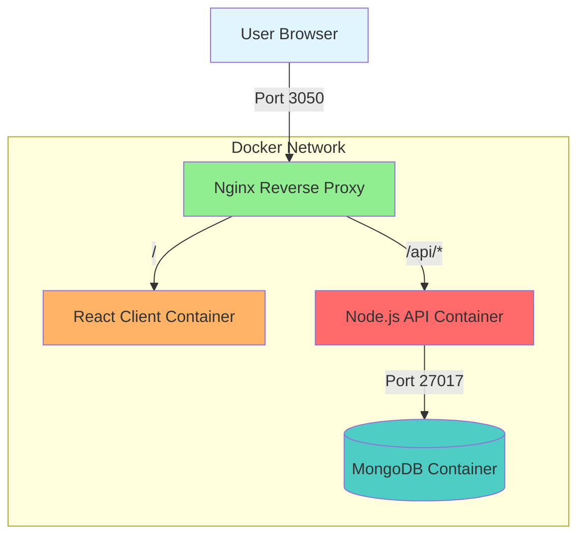
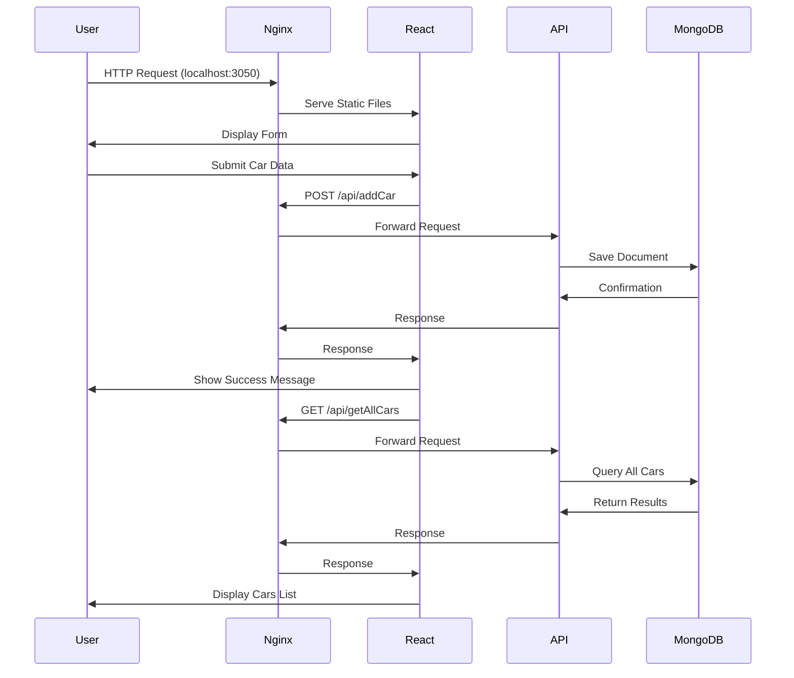
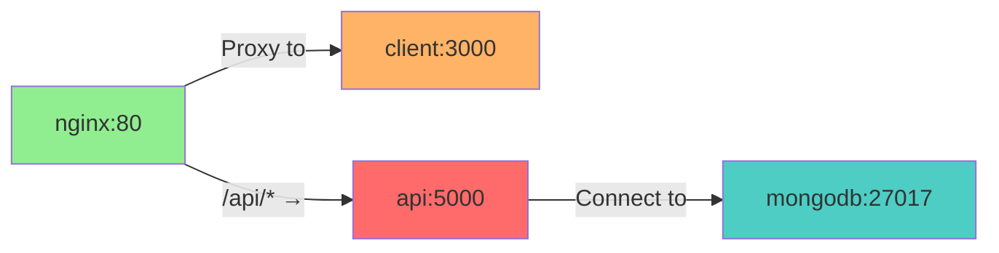

# Car Form Docker

Car Form Docker is a full-stack car management application demonstrating containerized web development with React.js, Node.js, Express, MongoDB, Nginx, and Docker Compose. Users can add vehicle details through a responsive form and browse stored entries with persistent MongoDB storage.

Built in December 2018, the project highlights a microservices architecture with Dockerized services, reverse proxy routing, REST API communication, CORS support, Bootstrap UI, multi-stage builds, and production-style deployment orchestration.

## Core Capabilities

- **Car Form Submission**: Add vehicle details (plate number, type, model)
- **Car Listing**: View all previously submitted cars
- **Docker Orchestration**: Multi-container deployment with Docker Compose
- **Responsive UI**: Mobile-friendly interface using Bootstrap
- **RESTful API**: Clean API endpoints for client-server communication

## Technical Excellence

- **Microservices Architecture**: Separated client, server, and database services
- **Multi-Stage Builds**: Optimized Docker images for production
- **Reverse Proxy**: Nginx for routing and static file serving
- **Database Persistence**: MongoDB for data storage
- **CORS Support**: Cross-origin requests enabled for development

## Developer Experience

- **Hot Reloading**: Development mode with automatic refresh
- **Containerized Dependencies**: No need to install Node.js or MongoDB locally
- **Consistent Environment**: Same setup across all development machines
- **Easy Deployment**: Single command to start all services

## Architecture Principles

1. **Separation of Concerns**: Client, server, and database are independent services
2. **Containerization**: Each service runs in its own Docker container
3. **Scalability**: Services can be scaled independently
4. **Maintainability**: Clean code structure with clear responsibilities
5. **Portability**: Runs the same on any machine with Docker installed

## Design Patterns

- **Microservices Pattern**: Independent services communicating via REST API
- **Repository Pattern**: Mongoose models abstract database operations
- **Proxy Pattern**: Nginx as reverse proxy for routing
- **Model-View-Controller (MVC)**: Clear separation in both client and server

## Installation

### Prerequisites

- Docker (v20.x or higher)
- Docker Compose (v3.x or higher)

### Steps

1. Clone the repository:

   ```bash
   git clone https://github.com/orassayag/car-form-docker.git
   cd car-form-docker
   ```

2. Start all services:

   ```bash
   docker-compose up --build
   ```

3. Open your browser and navigate to:
   ```
   http://localhost:3050
   ```

## Configuration

### Docker Configuration

The `docker-compose.yml` file defines all services and their configurations:

- **nginx**: Reverse proxy on port 3050
- **client**: React application (internal port 3000)
- **server**: Node.js API (internal port 5000)
- **mongodb**: MongoDB database (internal port 27017)

### Client Configuration

Client environment settings are located in:

- `client/src/settings/settings.development.json` - Development settings
- `client/src/settings/settings.production.json` - Production settings

### Server Configuration

Server settings are in `server/index.js`, including:

- MongoDB connection string
- Server port
- CORS configuration

## Directory Structure

```
car-form-docker/
├── client/                    # React frontend application
│   ├── config/               # Webpack & Jest configuration
│   ├── public/               # Static assets
│   ├── src/
│   │   ├── api/             # API client logic
│   │   ├── components/      # Reusable React components
│   │   ├── containers/      # Page containers (Home, App)
│   │   ├── hoc/             # Higher-order components
│   │   ├── settings/        # Environment configurations
│   │   └── utils/           # Utility functions
│   ├── Dockerfile           # Multi-stage build for production
│   └── package.json
├── server/                   # Node.js/Express backend
│   ├── models/              # Mongoose schemas
│   ├── index.js             # API server entry point
│   ├── Dockerfile
│   └── package.json
├── nginx/                    # Nginx reverse proxy
│   ├── default.conf         # Proxy configuration
│   └── Dockerfile
├── docker-compose.yml        # Service orchestration
└── README.md
```

## Usage

### Adding a Car

1. Fill in the vehicle number
2. Select the car type from the dropdown
3. Enter the car model
4. Click "Save Changes"

### Viewing Cars

- All submitted cars are listed below the form
- Data persists across browser refreshes and container restarts

### Docker Commands

```bash
# Start all services
docker-compose up

# Rebuild and start
docker-compose up --build

# Stop all services
docker-compose down

# View logs
docker-compose logs

# List containers
docker-compose ps
```

## Best Practices

### Development

1. **Use Docker for Development**: Ensures consistent environment
2. **Test Changes Locally**: Verify changes before committing
3. **Keep Dependencies Updated**: Regularly update npm packages
4. **Follow Code Style**: Use the provided ESLint and Prettier configurations

### Production

1. **Use Multi-Stage Builds**: Already configured in Dockerfiles
2. **Set Environment Variables**: Configure production settings
3. **Backup Database**: Regularly backup MongoDB data
4. **Monitor Logs**: Keep an eye on application logs

### Security

1. **Never Commit Secrets**: Keep API keys and credentials out of version control
2. **Use HTTPS**: In production, configure SSL certificates
3. **Limit Database Access**: Restrict MongoDB access to the API server only

## Features

- 🚗 Add car information (vehicle number, type, model)
- 📋 View list of previously submitted cars
- 🐳 Full Docker containerization
- 🔄 Real-time data persistence with MongoDB
- 🎨 Responsive UI with Bootstrap
- 🔐 CORS-enabled REST API
- ⚡ Production-ready with Nginx reverse proxy
- 📦 Multi-stage Docker builds for optimization

## Architecture



## Technology Stack

### Frontend

- **React.js** - UI library for building interactive interfaces
- **Bootstrap 4** - Responsive CSS framework
- **Axios** - HTTP client for API requests
- **SCSS** - CSS preprocessor for styling
- **Webpack** - Module bundler

### Backend

- **Node.js** - JavaScript runtime
- **Express** - Web application framework
- **Mongoose** - MongoDB object modeling
- **CORS** - Cross-origin resource sharing middleware
- **Winston** - Logging library

### Infrastructure

- **Docker** - Containerization platform
- **Docker Compose** - Multi-container orchestration
- **Nginx** - Reverse proxy and static file server
- **MongoDB** - NoSQL database

## Getting Started

### Quick Start with Docker

1. Clone the repository:

```bash
git clone https://github.com/orassayag/car-form-docker.git
cd car-form-docker
```

2. Start all services:

```bash
docker-compose up --build
```

3. Open your browser:

```
http://localhost:3050
```

That's it! The application is now running with all services containerized.

### Local Development Setup

See the [INSTRUCTIONS.md](INSTRUCTIONS.md) file for detailed setup instructions without Docker.

## Project Structure

```
car-form-docker/
├── client/                    # React frontend application
│   ├── config/               # Webpack & Jest configuration
│   ├── public/               # Static assets
│   ├── src/
│   │   ├── api/             # API client logic
│   │   ├── components/      # Reusable React components
│   │   ├── containers/      # Page containers (Home, App)
│   │   ├── hoc/             # Higher-order components
│   │   ├── settings/        # Environment configurations
│   │   └── utils/           # Utility functions
│   ├── Dockerfile           # Multi-stage build for production
│   └── package.json
├── server/                   # Node.js/Express backend
│   ├── models/              # Mongoose schemas
│   ├── index.js             # API server entry point
│   ├── Dockerfile
│   └── package.json
├── nginx/                    # Nginx reverse proxy
│   ├── default.conf         # Proxy configuration
│   └── Dockerfile
├── docker-compose.yml        # Service orchestration
└── README.md
```

## Application Flow



## API Documentation

### Endpoints

#### POST `/api/addCar`

Create a new car entry.

**Request:**

```json
{
  "vehicleNumber": "ABC-123",
  "carType": "Sedan",
  "carModel": "Toyota Camry"
}
```

**Response:** `200 OK`

```json
{
  "_id": "507f1f77bcf86cd799439011",
  "vehicleNumber": "ABC-123",
  "carType": "Sedan",
  "carModel": "Toyota Camry"
}
```

#### GET `/api/getAllCars`

Retrieve all car entries.

**Response:** `200 OK`

```json
[
  {
    "_id": "507f1f77bcf86cd799439011",
    "vehicleNumber": "ABC-123",
    "carType": "Sedan",
    "carModel": "Toyota Camry"
  }
]
```

### Supported Car Types

- Hatchback
- Sedan
- MPV
- SUV
- Crossover
- Coupe
- Convertible

## Docker Services

The application runs four interconnected containers:

| Service     | Image        | Port  | Description                    |
| ----------- | ------------ | ----- | ------------------------------ |
| **nginx**   | nginx:latest | 3050  | Reverse proxy, routes requests |
| **client**  | node:alpine  | 3000  | React frontend (internal)      |
| **api**     | node:alpine  | 5000  | Express API server (internal)  |
| **mongodb** | mongo:latest | 27017 | Database (internal)            |

### Container Communication



## Development

### Available Scripts

#### Client

```bash
cd client
npm start      # Start development server
npm build      # Create production build
npm test       # Run tests
```

#### Server

```bash
cd server
npm start      # Start API server
```

#### Docker Commands

```bash
docker-compose up          # Start all services
docker-compose up --build  # Rebuild and start
docker-compose down        # Stop all services
docker-compose logs        # View logs
docker-compose ps          # List containers
```

## Contributing

Contributions are welcome! Please read the [CONTRIBUTING.md](CONTRIBUTING.md) file for guidelines on how to contribute to this project.

### Ways to Contribute

- Report bugs and issues
- Suggest new features
- Improve documentation
- Submit pull requests

## Versioning

We use [SemVer](http://semver.org/) for versioning. For the versions available, see the [tags on this repository](https://github.com/orassayag/car-form-docker/tags).

## Author

- **Or Assayag** - _Initial work_ - [orassayag](https://github.com/orassayag)
- Or Assayag <orassayag@gmail.com>
- GitHub: https://github.com/orassayag
- StackOverflow: https://stackoverflow.com/users/4442606/or-assayag?tab=profile
- LinkedIn: https://linkedin.com/in/orassayag

## License

This application has an MIT license - see the [LICENSE](LICENSE) file for details.

## Acknowledgments

- Built for educational and research purposes
- Respects robots.txt and implements rate limiting
- Uses user-agent rotation to avoid detection
- Implements polite crawling practices
