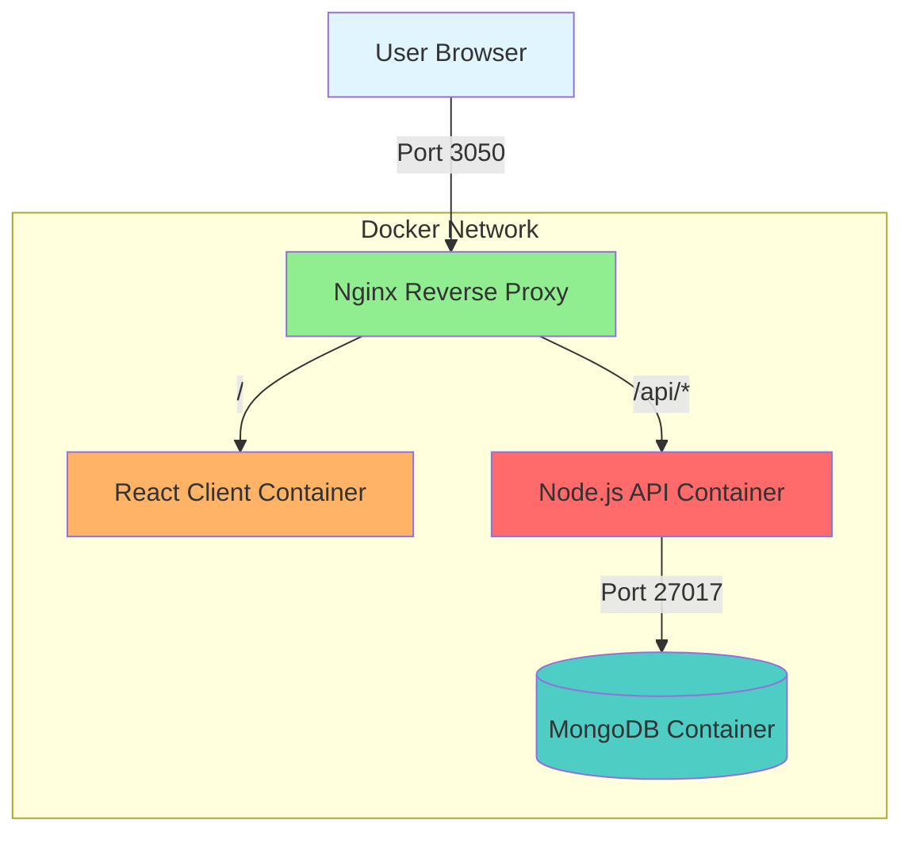
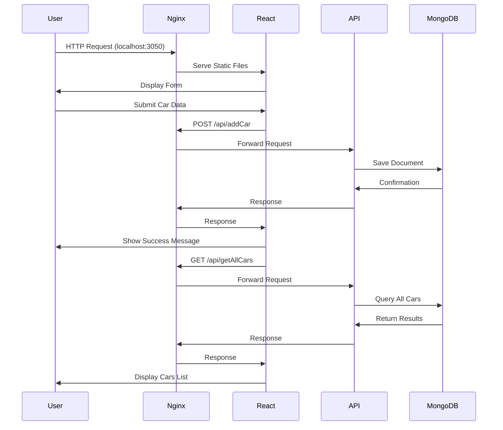
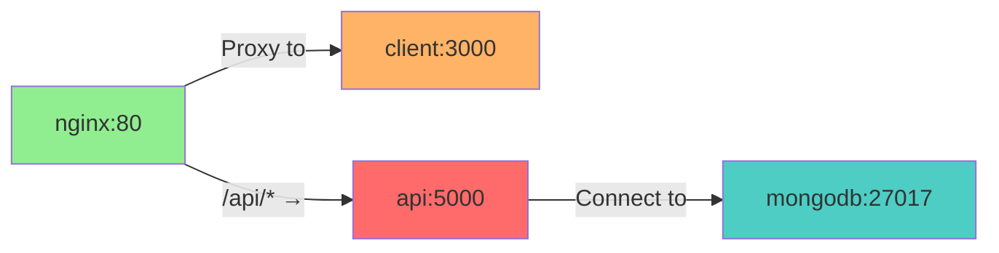

# Car Form Docker

A full-stack car management application demonstrating Docker containerization with React.js, Node.js, Express, MongoDB, and Nginx. Users can submit car information through a web form and view previously submitted entries.

Built in December 2018. This project showcases a complete microservices architecture with Docker Compose orchestration, demonstrating best practices for containerized web application deployment.

## Features

- 🚗 Add car information (vehicle number, type, model)
- 📋 View list of previously submitted cars
- 🐳 Full Docker containerization
- 🔄 Real-time data persistence with MongoDB
- 🎨 Responsive UI with Bootstrap
- 🔐 CORS-enabled REST API
- ⚡ Production-ready with Nginx reverse proxy
- 📦 Multi-stage Docker builds for optimization

## Architecture



## Technology Stack

### Frontend
- **React.js** - UI library for building interactive interfaces
- **Bootstrap 4** - Responsive CSS framework
- **Axios** - HTTP client for API requests
- **SCSS** - CSS preprocessor for styling
- **Webpack** - Module bundler

### Backend
- **Node.js** - JavaScript runtime
- **Express** - Web application framework
- **Mongoose** - MongoDB object modeling
- **CORS** - Cross-origin resource sharing middleware
- **Winston** - Logging library

### Infrastructure
- **Docker** - Containerization platform
- **Docker Compose** - Multi-container orchestration
- **Nginx** - Reverse proxy and static file server
- **MongoDB** - NoSQL database

## Getting Started

### Prerequisites

- Docker (v20.x or higher)
- Docker Compose (v3.x or higher)

For local development without Docker:
- Node.js (v8.11.3 or higher)
- npm or yarn
- MongoDB

### Quick Start with Docker

1. Clone the repository:
```bash
git clone https://github.com/orassayag/car-form-docker.git
cd car-form-docker
```

2. Start all services:
```bash
docker-compose up --build
```

3. Open your browser:
```
http://localhost:3050
```

That's it! The application is now running with all services containerized.

### Local Development Setup

See the [INSTRUCTIONS.md](INSTRUCTIONS.md) file for detailed setup instructions without Docker.

## Project Structure

```
car-form-docker/
├── client/                    # React frontend application
│   ├── config/               # Webpack & Jest configuration
│   ├── public/               # Static assets
│   ├── src/
│   │   ├── api/             # API client logic
│   │   ├── components/      # Reusable React components
│   │   ├── containers/      # Page containers (Home, App)
│   │   ├── hoc/             # Higher-order components
│   │   ├── settings/        # Environment configurations
│   │   └── utils/           # Utility functions
│   ├── Dockerfile           # Multi-stage build for production
│   └── package.json
├── server/                   # Node.js/Express backend
│   ├── models/              # Mongoose schemas
│   ├── index.js             # API server entry point
│   ├── Dockerfile
│   └── package.json
├── nginx/                    # Nginx reverse proxy
│   ├── default.conf         # Proxy configuration
│   └── Dockerfile
├── docker-compose.yml        # Service orchestration
└── README.md
```

## Application Flow



## API Documentation

### Endpoints

#### POST `/api/addCar`
Create a new car entry.

**Request:**
```json
{
  "vehicleNumber": "ABC-123",
  "carType": "Sedan",
  "carModel": "Toyota Camry"
}
```

**Response:** `200 OK`
```json
{
  "_id": "507f1f77bcf86cd799439011",
  "vehicleNumber": "ABC-123",
  "carType": "Sedan",
  "carModel": "Toyota Camry"
}
```

#### GET `/api/getAllCars`
Retrieve all car entries.

**Response:** `200 OK`
```json
[
  {
    "_id": "507f1f77bcf86cd799439011",
    "vehicleNumber": "ABC-123",
    "carType": "Sedan",
    "carModel": "Toyota Camry"
  }
]
```

### Supported Car Types
- Hatchback
- Sedan
- MPV
- SUV
- Crossover
- Coupe
- Convertible

## Docker Services

The application runs four interconnected containers:

| Service | Image | Port | Description |
|---------|-------|------|-------------|
| **nginx** | nginx:latest | 3050 | Reverse proxy, routes requests |
| **client** | node:alpine | 3000 | React frontend (internal) |
| **api** | node:alpine | 5000 | Express API server (internal) |
| **mongodb** | mongo:latest | 27017 | Database (internal) |

### Container Communication



## Development

### Available Scripts

#### Client
```bash
cd client
npm start      # Start development server
npm build      # Create production build
npm test       # Run tests
```

#### Server
```bash
cd server
npm start      # Start API server
```

#### Docker Commands
```bash
docker-compose up          # Start all services
docker-compose up --build  # Rebuild and start
docker-compose down        # Stop all services
docker-compose logs        # View logs
docker-compose ps          # List containers
```

## Contributing

Contributions are welcome! Please read the [CONTRIBUTING.md](CONTRIBUTING.md) file for guidelines on how to contribute to this project.

### Ways to Contribute
- Report bugs and issues
- Suggest new features
- Improve documentation
- Submit pull requests

## Versioning

We use [SemVer](http://semver.org/) for versioning. For the versions available, see the [tags on this repository](https://github.com/orassayag/car-form-docker/tags).

## Author

* **Or Assayag** - *Initial work* - [orassayag](https://github.com/orassayag)
* Or Assayag <orassayag@gmail.com>
* GitHub: https://github.com/orassayag
* StackOverflow: https://stackoverflow.com/users/4442606/or-assayag?tab=profile
* LinkedIn: https://linkedin.com/in/orassayag

## License

This project is licensed under the MIT License - see the [LICENSE](LICENSE) file for details.

## Acknowledgments

- Built as a demonstration of Docker containerization best practices
- Showcases microservices architecture with React and Node.js
- Demonstrates production-ready deployment with Nginx
- Uses Bootstrap for responsive UI design
